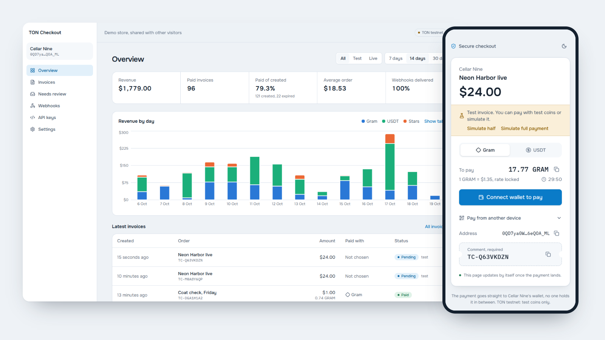
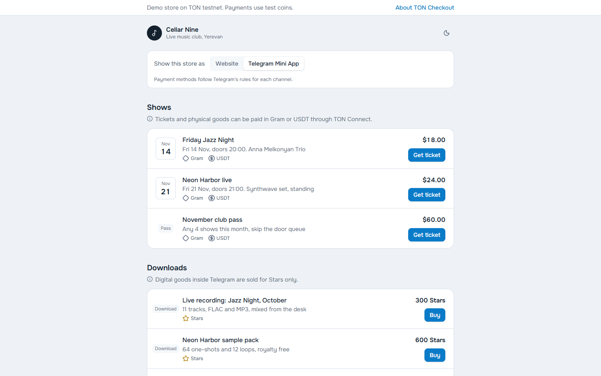
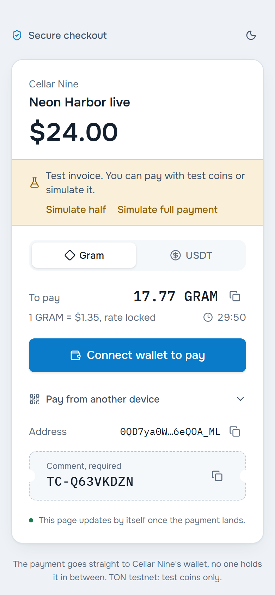
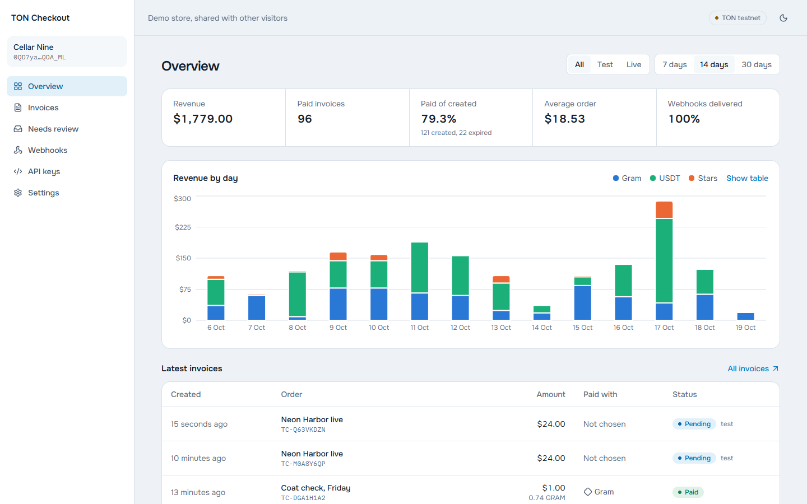
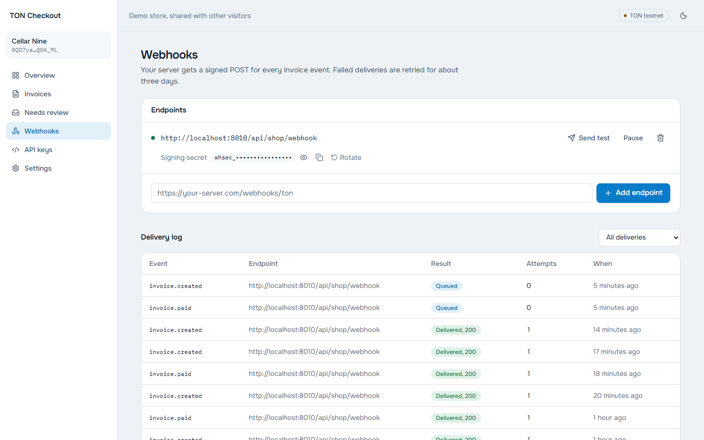

# TON Checkout

[](https://github.com/manch1915/ton-checkout/actions/workflows/ci.yml)

Payments in Gram, USDT and Telegram Stars for Telegram bots, Mini Apps and websites. Buyers pay straight to the merchant's wallet: the server watches the TON network, matches each transfer to its invoice and tells the merchant's backend with a signed webhook. It never holds funds and stores no private keys.



> Runs on TON testnet with test coins. Toncoin was renamed **Gram (GRAM)** in June 2026; the network is still TON and APIs still use the `TON` code, so the code says `TON` and the interface says Gram.

## What you get

- **Invoices in fiat, paid in crypto.** Price in USD or EUR, quoted in Gram and USDT at the rate of the moment and locked for the invoice lifetime.
- **TON Connect payments.** One tap from Keeper, My Wallet, Walt and other wallets in the registry, plus a QR code and `ton://` link for paying from another device. USDT is sent as a proper TEP-74 jetton transfer.
- **Telegram Stars** for digital goods in bots and Mini Apps, with pre-checkout checks and refunds. The public demo runs Stars in simulation mode (`STARS_DEMO=true`), so its bot never charges anyone; set it to `false` to sell for real Stars.
- **Telegram's rules built in.** Each invoice offers only the methods allowed for its product type and channel: Stars only for digital goods inside Telegram, Gram and USDT for tickets and physical goods, any on-chain method on a website.
- **Chain watcher** on toncenter v3 with TonAPI as a drop-in alternative. It handles underpayment, top-ups, overpayment, late payment, fake USDT jettons, duplicate deliveries and unfinalized transactions.
- **Live status for the buyer** over server-sent events, with polling as a fallback.
- **Signed webhooks** in the [Standard Webhooks](https://www.standardwebhooks.com) format: HMAC-SHA256, retries with backoff for about three days, a delivery log with replay and test events.
- **Merchant dashboard:** revenue by day and currency, invoice filters and CSV export, payments without a code queued for manual matching, API keys, webhook endpoints, settings. Merchants sign in with their wallet through TON Connect `ton_proof`.
- **Embeds anywhere:** a 1 KB widget for websites, a Mini App storefront, bot examples for aiogram and grammY.
- **Test mode** with a payment simulator that goes through the same processing code as real payments.

## Try it

The demo store, **Cellar Nine**, is a small music club selling concert tickets (Gram or USDT) and recordings (Stars inside Telegram). Its toggle shows how the allowed payment methods change between a website and a Mini App.

| | |
|---|---|
|  |  |
|  |  |

Run everything locally:

```bash
cp .env.example .env   # set SECRET_KEY and DEMO_WALLET_ADDRESS
docker compose up --build
```

Open <http://localhost:5180>. The first start applies migrations and seeds the demo store with two weeks of orders. **Open the demo store** on the sign-in page gets you into the dashboard without a wallet.

## How a payment works

```text
merchant backend ──POST /v1/invoices──▶ API ──quotes, reference TC-XXXXXXXX──▶ Postgres
buyer ──TON Connect / QR──▶ merchant wallet (comment = reference)
worker ──toncenter v3──▶ new transfers on the merchant wallet
       └─ match by reference, check amount, jetton master, wallet ─▶ invoice paid
       └─ event + webhook deliveries ─▶ merchant backend (signed, retried)
       └─ Redis pub/sub ─▶ API ─SSE─▶ payment page
```

All payments go to the merchant's own wallet with a short reference in the comment, which is the invoice model from the official [Gram payments processing](https://docs.ton.org/applications/payments/gram) guide. There are no deposit wallets and no sweeping, so the server has no keys to lose. A payment without a usable comment is still recorded and shows up under **Needs review** in the dashboard, where it can be matched to an order by hand.

## Architecture

The backend is a FastAPI application in clean layers. `domain/` holds pure rules: invoice statuses, how a transfer changes an invoice, fiat-to-asset quoting, and which payment methods each channel allows. `services/` holds the use cases (invoices, payment processing, webhook dispatch, the chain watcher, `ton_proof` login, stats). `infrastructure/` adapts PostgreSQL, Redis, the TON indexers, exchange rates and the Telegram Bot API, and the services depend only on small protocols such as `ChainProvider` and `RateSource`. Processing is idempotent on the transaction hash, so rescanning history or receiving the same transaction twice never counts money twice. A separate worker process runs the watcher, invoice expiry, webhook delivery and the bot.

The frontend is a Vite + React 19 app with Tailwind CSS 4, TanStack Query and TON Connect UI. It covers the payment page, the demo store (which doubles as the Mini App), the dashboard and the landing page. TON Connect is loaded only on pages that talk to wallets. The embed widget is a separate dependency-free bundle, `checkout.js`.

## Merchant API

```bash
curl http://localhost:5180/v1/invoices \
  -H "Authorization: Bearer sk_test_..." \
  -H "Content-Type: application/json" \
  -d '{"amount": "24.00", "description": "Neon Harbor live", "order_id": "A-1042",
       "product_kind": "offline_service", "return_url": "https://shop.example/orders/A-1042"}'
```

| Method | Path | |
|---|---|---|
| `POST` | `/v1/invoices` | Create an invoice. Returns `pay_url`, `reference` and a quote per asset |
| `GET` | `/v1/invoices` | List invoices, filter by `status` and `asset` |
| `GET` | `/v1/invoices/{id}` | One invoice |
| `POST` | `/v1/invoices/{id}/cancel` | Cancel an open invoice |

Interactive documentation is served at `/api/docs`. Deployment behind Caddy is described in [docs/deploy.md](docs/deploy.md).

**Webhook events:** `invoice.created`, `invoice.partially_paid`, `invoice.paid`, `invoice.expired`, `invoice.canceled`. The body is `{"id", "type", "created_at", "data": {"invoice": {...}}}` and the headers are `webhook-id`, `webhook-timestamp` and `webhook-signature`. Verify them with any Standard Webhooks library:

```python
from standardwebhooks import Webhook

event = Webhook("whsec_...").verify(body, headers)
```

**Embed on a site:**

```html
<script src="https://your-checkout/checkout.js" defer></script>
<button data-ton-checkout="inv_...">Pay with Gram</button>
<script>
  addEventListener("ton-checkout:paid", (e) => console.log(e.detail.invoiceId));
</script>
```

Bots: [`examples/`](examples) has a ticket bot on aiogram and one on grammY.

## Testnet walkthrough

`backend/tools/testnet.py` creates demo wallets, deploys a test USDT jetton (6 decimals, like real USDT) and pays invoices from a real wallet. Mnemonics stay in a git-ignored file.

```bash
cd backend
uv run --group tools python -m tools.testnet wallets          # merchant and payer wallets
# fund the payer with test coins from @testgiver_ton_bot
uv run --group tools python -m tools.testnet deploy-jetton    # prints USDT_JETTON_MASTER
uv run --group tools python -m tools.testnet mint --to <payer address> --amount 500
uv run --group tools python -m tools.testnet pay inv_... --asset USDT
```

## Development

Requirements: Python 3.13 with [uv](https://docs.astral.sh/uv/), Node 22, Docker.

```bash
docker compose up -d db redis

cd backend
cp .env.example .env               # then set DEMO_WALLET_ADDRESS
uv sync
uv run alembic upgrade head
uv run python -m app.seed
uv run fastapi dev --port 8010     # API
uv run python -m app.worker        # watcher, webhooks, bot

cd ../web
npm install
npm run dev                        # http://localhost:5180, proxies /api to :8010
```

Checks, the same ones CI runs:

```bash
cd backend && uv run ruff check . && uv run mypy app && uv run pytest
cd web && npm run lint && npm run typecheck && npm test
```

The backend suite runs against a real PostgreSQL and covers the abuse cases from the TON payments guide: reusing a settled reference, paying less, a fake jetton named USDT, dust with junk comments, payments to the wrong wallet. It also covers webhook signatures (checked against the official verifier), DNS-rebinding protection for webhook URLs, and `ton_proof` with a wallet that rotated its key.

## Project layout

```text
backend/
  app/domain/          statuses, matching rules, pricing, payment policy
  app/services/        invoices, payments, webhooks, watcher, ton_proof, stats, Stars
  app/infrastructure/  database, toncenter and TonAPI, rates, Redis bus, Bot API
  app/api/             payment page (SSE), merchant API, dashboard, auth
  app/demo_shop/       the Cellar Nine store, an example merchant on the same API
  tools/testnet.py     wallets, test jetton, real testnet payments
web/
  src/features/pay        payment page
  src/features/shop       demo store and Mini App
  src/features/dashboard  merchant dashboard
  src/widget/embed.ts     checkout.js
examples/              aiogram and grammY bots
```

## Notes

- Testnet only. To go to mainnet, set `TON_NETWORK=mainnet`, `USDT_JETTON_MASTER=EQCxE6mUtQJKFnGfaROTKOt1lZbDiiX1kCixRv7Nw2Id_sDs` (6 decimals) and a toncenter API key.
- Exchange rates come from TonAPI, with CoinGecko as the fallback. On testnet the quotes use mainnet prices.
- Telegram's [terms for bot developers](https://telegram.org/tos/bot-developers) require Stars for digital goods sold inside Telegram, and TON Connect for crypto in Mini Apps. The payment policy in `domain/payment_policy.py` encodes this.

## License

MIT
